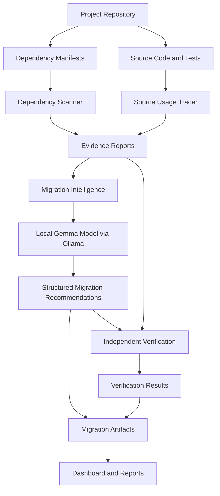
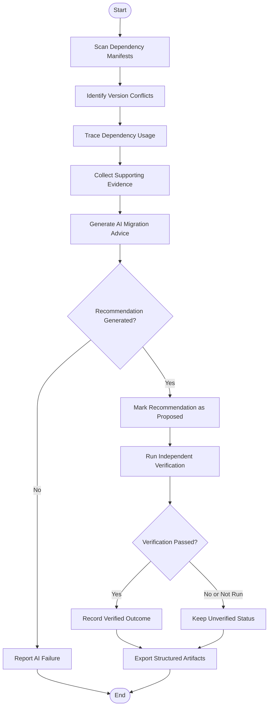
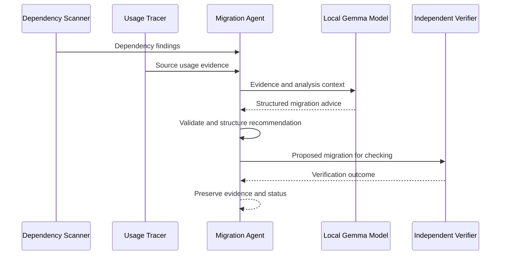

# 🔭 PatchProof
### Evidence-Driven Dependency Migration Intelligence

**Team TwoPointers · Hacktoberfest · K. J. Somaiya College of Engineering**

PatchProof is an evidence-driven dependency analysis and migration intelligence system built on the LinkWatch project foundation. It examines dependency declarations, traces source-code usage, identifies inconsistencies, and uses a locally hosted Gemma model to generate structured migration recommendations grounded in collected evidence.

Rather than treating AI-generated suggestions as verified fixes, PatchProof separates **evidence collection, AI reasoning, and independent verification** to make dependency migration more transparent and auditable.

---

## 👥 Team

| Name | Role |
|---|---|
| Tejaswee Rajput | Person 2 — AI migration intelligence, evidence-grounded reasoning, and validation |
| Sohana Pilli | Person 3 — Frontend, dashboard, and integration |
| Rahul Sharma | Person 1 — Dependency scanning, usage tracing, and verification |

**Team Name:** TwoPointers  
**Event:** Hacktoberfest  
**Institution:** K. J. Somaiya College of Engineering

---

## 🎯 Problem Statement

Dependency migrations are a recurring challenge in software development. A project may declare conflicting dependency versions across configuration files, contain packages with unclear source-code usage, or rely on outdated dependencies that behave differently with newer releases.

Developers must often investigate these inconsistencies manually across manifests, imports, compatibility requirements, and test results.

PatchProof aims to simplify this process by connecting dependency evidence with AI-assisted migration reasoning and independent verification.

### Our objectives

- Detect conflicting dependency declarations across project manifests.
- Trace dependency usage in source code and tests.
- Generate structured, evidence-grounded migration recommendations using a local Gemma model.
- Distinguish observed facts from AI-generated hypotheses.
- Support independent verification before a proposed migration is treated as successful.
- Produce reusable, machine-readable evidence and migration outputs.

---

## ✨ Key Features

- **Dependency conflict detection:** Identifies inconsistencies across dependency manifests.
- **Source usage tracing:** Searches application code and tests for dependency imports.
- **Local AI reasoning:** Uses Ollama to run the configured Gemma model locally.
- **Evidence-grounded recommendations:** Provides migration reasoning based on available project evidence.
- **Structured AI output:** Organizes recommendations into a machine-readable format.
- **Verification-first design:** Keeps proposed recommendations separate from independently verified outcomes.
- **Reusable artifacts:** Generates JSON evidence and usage reports for downstream analysis and integration.

---

## 🏗️ System Architecture

The following diagram describes the intended end-to-end PatchProof architecture.



*Architecture note: this diagram represents the intended integrated workflow. Individual components and integration points should be verified against the final submitted code.*

---

## 🔄 End-to-End Workflow



The workflow is designed to prevent an AI-generated recommendation from being presented as a verified fix before independent checks have been completed.

---

## 🧠 AI-Assisted Dependency Migration

PatchProof uses a local language model to help interpret dependency evidence and propose migration strategies.

### AI processing flow



### Why local inference?

- Keeps model inference on the local machine when using a local Ollama instance.
- Avoids requiring a hosted inference API for the configured model.
- Enables experimentation with dependency migration reasoning.
- Makes model availability and runtime requirements explicit.

Local inference does not automatically guarantee correctness. Recommendations still require appropriate validation and verification.

---

## 🔎 Example Finding

During a dependency evidence scan, PatchProof identified conflicting Pydantic declarations:

| File | Declaration |
|---|---|
| `requirements.txt` | `pydantic==1.10.13` |
| `pyproject.toml` | `pydantic>=2` |

**Finding:** The project contains inconsistent dependency declarations.

This is an observed configuration inconsistency. It does not, by itself, establish which version is correct or prove that the application fails at runtime. PatchProof's migration intelligence can use this evidence to formulate a recommendation, while verification must determine whether a proposed resolution actually works.

---

## 🛠️ Technology Stack

| Technology | Purpose |
|---|---|
| Python | Core implementation and analysis |
| Ollama | Local model runtime |
| Gemma | AI-assisted migration reasoning |
| JSON | Machine-readable evidence and recommendations |
| TOML and requirements files | Dependency declaration inputs |
| Pytest | Automated testing |
| Mermaid | Architecture and workflow documentation |

The final submission should reflect the actual dependencies and components present in the submitted repository.

---

## 📁 Project Structure

```text
PatchProof/
├── patchproof/
│   ├── scanner.py
│   ├── usage.py
│   └── ai/
│       ├── migration_agent.py
│       ├── ollama_adapter.py
│       └── ...
├── linkwatch/
│   └── ... original LinkWatch foundation
├── tests/
├── requirements.txt
├── pyproject.toml
└── README.md
```

*The tree above is illustrative. Preserve the actual filenames and directories in the final repository rather than adding placeholder files just to match this diagram.*

---

## 🚀 Getting Started

### Prerequisites

- Python compatible with the project's dependency set
- Git
- [Ollama](https://ollama.com/download)
- The Gemma model configured by the project
- A working local Ollama service

### 1. Clone the repository

```bash
git clone <YOUR_PATCHPROOF_REPOSITORY_URL>
cd <YOUR_PATCHPROOF_DIRECTORY>
```

### 2. Create and activate a virtual environment

**Windows — Command Prompt**

```bat
py -3.12 -m venv .venv
.venv\Scripts\activate
```

**macOS/Linux**

```bash
python3 -m venv .venv
source .venv/bin/activate
```

Use the Python version supported by the final project's dependencies.

### 3. Install dependencies

```bash
python -m pip install -r requirements.txt
```

Install development dependencies separately if the repository provides a development requirements file:

```bash
python -m pip install -r requirements-dev.txt
```

### 4. Configure the local model

Check which models are available:

```bash
ollama list
```

Pull the exact model configured by the migration agent if it is not installed. For the current configuration, the expected model identifier is:

```bash
ollama pull gemma4:e2b-it-q4_K_M
```

If that identifier is unavailable in your Ollama installation, use a supported model identifier and update the project configuration accordingly. The model name used by the application must match the installed model name.

### 5. Run the analysis pipeline

Run these commands from the project root, assuming the corresponding modules are present:

```bash
python -m patchproof.scanner
python -m patchproof.usage
python -m patchproof.ai.migration_agent
```

The scanner and usage tracer generate their respective evidence reports. The AI advisor requires the configured model to be available and the Ollama service to be reachable.

### 6. Inspect generated reports

```bash
python -m json.tool patchproof-report.json
python -m json.tool patchproof-usage-report.json
python -m json.tool patchproof-ai-advice.json
```

The AI advice file will only be available if the migration agent completes successfully.

---

## 🧪 Testing

Run the project's test suite from the repository root:

```bash
python -m pytest -q
```

Tests should cover dependency evidence extraction, source usage tracing, AI response validation, failure handling, and verification-state behavior where those components are implemented.

A passing test suite demonstrates that the covered tests pass; it does not independently establish that every proposed dependency migration is safe.

---

## 📦 Expected Outputs

| Artifact | Purpose |
|---|---|
| `patchproof-report.json` | Dependency findings and manifest evidence |
| `patchproof-usage-report.json` | Source-code dependency usage evidence |
| `patchproof-ai-advice.json` | Structured AI migration recommendations, when generation succeeds |
| Verification results | Outcome of independent checks, where implemented |

Exact artifact schemas and output paths should be documented from the final implementation.

---

## 🔐 Design Principles

1. **Evidence before inference:** Recommendations should be grounded in observable project data.
2. **Explicit uncertainty:** A hypothesis is not the same as a proven root cause.
3. **Verification before success:** A proposed change must not be labelled verified until the relevant checks pass.
4. **Traceability:** Keep findings, recommendations, and verification results distinguishable.
5. **Local-first inference:** Support local model execution through Ollama.
6. **Reproducibility:** Make configuration, model requirements, and test instructions clear.

---

## 🗺️ Future Scope

- Integrate a unified dashboard for findings, recommendations, and verification outcomes.
- Expand dependency compatibility analysis across additional ecosystems.
- Add automated, isolated migration test environments.
- Generate a reusable Dependency Exit Capsule containing structured evidence and migration outcomes.
- Support comparison of multiple migration hypotheses.
- Add CI integration for repeatable dependency checks.

These items are potential extensions and should not be interpreted as completed functionality unless present in the submitted implementation.

---

## 🤝 Acknowledgements

PatchProof builds on the LinkWatch project foundation by extending the project toward evidence-driven dependency analysis and AI-assisted migration intelligence.

We acknowledge the original LinkWatch maintainers and contributors whose work provided the starting point for this project.

---

## 📄 License

Retain the original repository's license and attribution requirements. Refer to the `LICENSE` file in the repository for the applicable terms.

---

<div align="center">

**Built by Team TwoPointers**

*Making dependency migration more evidence-driven, transparent, and verifiable.*

</div>
