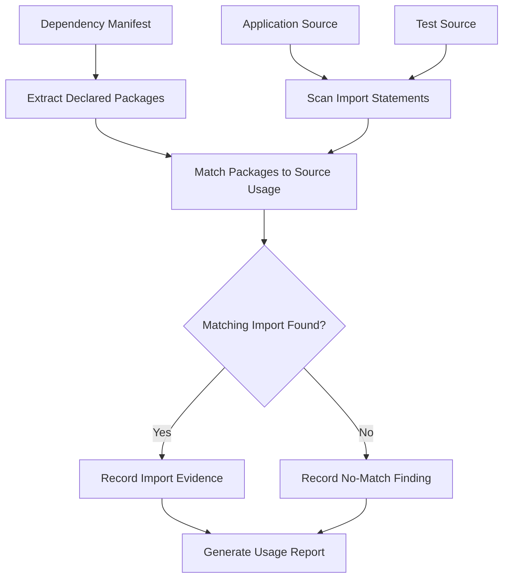
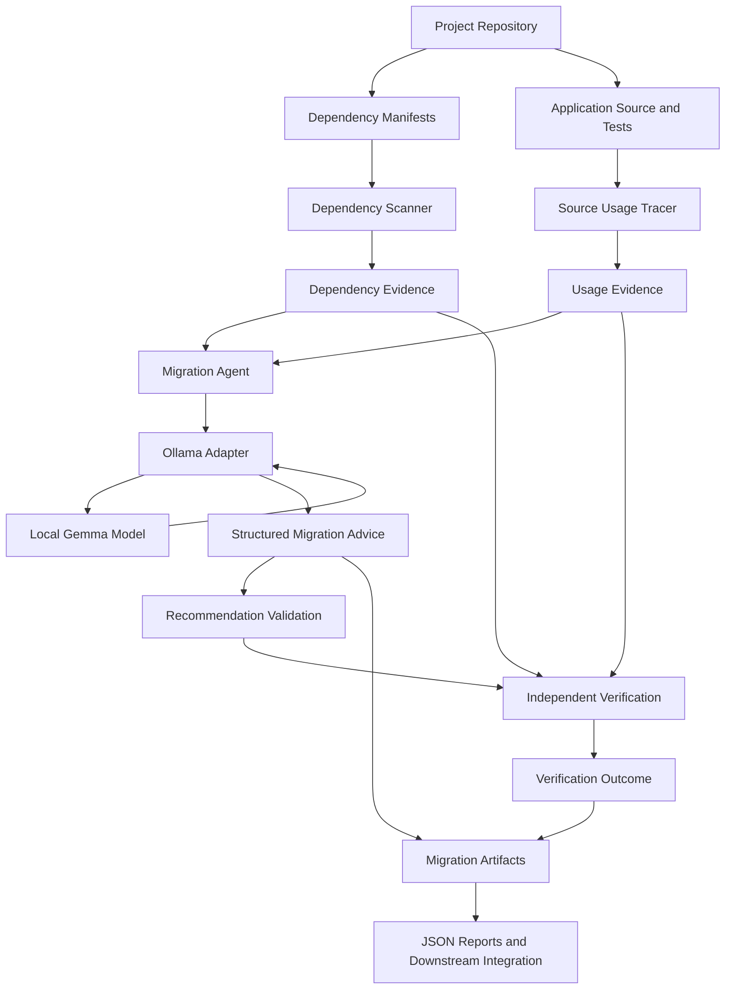
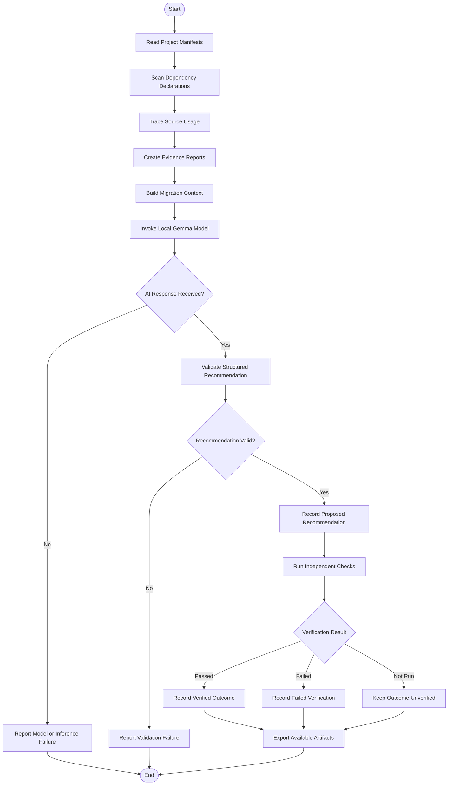

# 🔬 PATCHPROOF

## From Dependency Conflicts to Evidence-Backed Migration Decisions

<p align="center">
  <b>HACKTOBERFEST</b>
  <br/>
  <b>K. J. Somaiya College of Engineering</b>
  <br/><br/>
  <sub>Team TwoPointers • AI-Assisted Dependency Migration Intelligence</sub>
</p>

<p align="center">
  
  
  
  
  
  
</p>

---

# 🏆 Competition

## HACKTOBERFEST — PROJECT SUBMISSION

**Institution:** K. J. Somaiya College of Engineering

**Team Name:** TwoPointers

### Team Members

- **Tejaswee Rajput** — Team Lead
- **Sohana Pilli** — Team Member
- **Rahul Sharma** — Team Member

---

# 🚨 The Problem

Modern software projects depend on an increasingly complex ecosystem of external libraries, packages, and frameworks.

As projects evolve, dependency declarations can become inconsistent, packages can remain unused, and upgrades can introduce compatibility problems that are difficult to diagnose.

A dependency listed in one configuration file might require a different version from the one declared elsewhere. A package may be present in the dependency manifest without an obvious corresponding source-code import. An AI-generated migration suggestion may sound convincing without being supported by actual project evidence.

Developers are left to investigate these problems manually across configuration files, source code, compatibility constraints, and test results.

### The challenges

- Conflicting dependency declarations across project manifests.
- Limited visibility into how declared dependencies are used.
- Difficult migration decisions involving multiple possible versions.
- AI-generated recommendations that may lack supporting evidence.
- Confusion between a suspected problem and a confirmed root cause.
- Risk of treating a proposed fix as successful without running independent checks.
- Fragmented diagnostic information that is difficult to reuse or audit.

The fundamental question is:

> **How can developers move from dependency conflicts to trustworthy migration decisions without blindly trusting AI-generated fixes?**

---

# 💡 Our Solution

**PatchProof** is an evidence-driven dependency analysis and migration intelligence system built on the LinkWatch project foundation.

It combines dependency scanning, source-code usage tracing, local Gemma-powered reasoning, structured recommendations, and independent verification into a transparent migration workflow.

Instead of immediately changing dependencies based on an AI response, PatchProof first gathers evidence, analyzes the problem, proposes a resolution, and keeps verification outcomes separate from AI-generated hypotheses.

### The PatchProof pipeline

- 🔍 Dependency manifest scanning
- 📄 Declaration conflict detection
- 🧭 Source-code dependency usage tracing
- 🧠 Local Gemma-assisted migration reasoning
- 🧾 Evidence-grounded recommendations
- 📦 Structured JSON artifacts
- 🧪 Automated testing
- ⚖️ Independent verification workflow
- 🔐 Explicit distinction between proposed and verified outcomes
- 🔄 Reusable dependency migration evidence

PatchProof is designed around a simple principle:

> **AI may propose the fix. Evidence and verification must justify the result.**

---

# 🎯 Core Principle

PatchProof does not treat an AI-generated answer as proof that a dependency problem has been solved.

The system separates diagnosis, reasoning, and verification.

```text
DISCOVER
   ↓
COLLECT EVIDENCE
   ↓
TRACE USAGE
   ↓
ANALYSE CONFLICTS
   ↓
GENERATE MIGRATION ADVICE
   ↓
VALIDATE RECOMMENDATION
   ↓
INDEPENDENT VERIFICATION
   ↓
RECORD OUTCOME
   ↓
EXPORT EVIDENCE
```

The evidence layer records what was observed.

The AI layer proposes what could be done.

The verification layer determines what has actually been established.

---

# 🔎 Dependency Evidence Scanner

The dependency scanner examines supported project manifests and extracts declared dependencies for comparison.

### Responsibilities

- Discover supported dependency configuration files.
- Extract dependency names and version specifications.
- Compare declarations across manifests.
- Identify conflicting constraints.
- Produce structured findings for downstream analysis.

### Example finding

Consider a project with these declarations:

| File | Dependency declaration |
|---|---|
| `requirements.txt` | `pydantic==1.10.13` |
| `pyproject.toml` | `pydantic>=2` |

PatchProof identifies that the two files declare incompatible version requirements for the same dependency.

```text
PROJECT MANIFESTS
       │
       ▼
EXTRACT DECLARATIONS
       │
       ▼
NORMALIZE DEPENDENCY NAMES
       │
       ▼
COMPARE VERSION CONSTRAINTS
       │
       ▼
IDENTIFY INCONSISTENCIES
       │
       ▼
GENERATE EVIDENCE REPORT
```

A conflict is an observed inconsistency, not automatically proof of a runtime failure. Additional compatibility and runtime checks are needed to determine the appropriate resolution.

---

# 🧭 Source Usage Intelligence

A dependency manifest tells developers what a project declares. Source-code analysis helps explain where those dependencies appear to be used.

PatchProof's usage tracer searches supported project files for dependency imports and records matching locations.

### Usage classifications

- **IMPORT_FOUND** — a matching import was identified.
- **NO_MATCHING_IMPORT_FOUND** — no matching import was found by the implemented scan.

The second classification does not, by itself, prove that a package is safe to remove. Dynamic imports, indirect usage, plugins, command-line entry points, and other mechanisms may require additional investigation.

### Usage tracing workflow



This creates a more useful diagnostic picture by combining declared dependencies with observable source usage.

---

# 🧠 Local AI Migration Intelligence

PatchProof uses a locally hosted Gemma model through Ollama to help interpret dependency findings and formulate migration recommendations.

Rather than sending an unstructured question to a model, the migration agent supplies relevant findings and project context, then processes the model response into a structured recommendation.

### AI processing capabilities

- Interpret dependency declaration conflicts.
- Compare possible migration approaches.
- Explain potential compatibility concerns.
- Generate structured migration advice.
- Preserve the distinction between observed evidence and proposed solutions.
- Provide a machine-readable output for downstream tooling.

### Why local inference?

- Runs inference through a local Ollama service.
- Avoids requiring a hosted inference API for the configured model.
- Makes the model dependency explicit and testable.
- Supports experimentation with migration reasoning using local project evidence.

Local execution does not guarantee that a recommendation is correct. Model availability, response validation, and independent verification remain important.

---

# 🏗️ System Architecture

The following diagram describes PatchProof's evidence-driven processing architecture.



*The diagram represents the intended end-to-end architecture. The exact verification and downstream integration capabilities depend on the components included in the final submitted build.*

---

# 🔄 End-to-End Workflow

PatchProof is organized into distinct stages so that each stage has a clear responsibility.



A recommendation is not automatically marked as successful merely because the model returned a valid response.

---

# 🧾 Evidence vs. Hypothesis vs. Verification

One of PatchProof's central design goals is to preserve the difference between what the system observes and what it infers.

| Stage | Meaning |
|---|---|
| Observed evidence | Information extracted from project files or tool results |
| AI hypothesis | A model-generated explanation or proposed resolution |
| Validated recommendation | A recommendation that satisfies the implemented output-validation rules |
| Verified outcome | A result supported by completed independent checks |

### Example

```text
OBSERVATION
    │
    └── Two manifests declare conflicting Pydantic constraints.
             │
             ▼
AI HYPOTHESIS
    │
    └── Propose a compatible dependency strategy.
             │
             ▼
VALIDATION
    │
    └── Check the recommendation's structure and required fields.
             │
             ▼
INDEPENDENT VERIFICATION
    │
    ├── Checks pass → Record verified outcome.
    ├── Checks fail → Record failed verification.
    └── Checks not run → Keep outcome unverified.
```

This separation helps prevent plausible-sounding model output from being mistaken for an established engineering result.

---

# 🧪 Testing and Reliability

PatchProof includes automated tests for the implemented analysis and AI components.

Testing can help establish whether:

- Dependency findings are extracted correctly for supported manifests.
- Source usage reports contain the expected classifications.
- AI responses are handled according to the adapter's validation rules.
- Invalid or unexpected responses are handled appropriately.
- Implemented schema and migration logic behaves as expected.

Run the tests from the repository root:

```bash
python -m pytest -q
```

For syntax validation of the AI package:

```bash
python -m compileall -q patchproof/ai
```

A passing test suite establishes that the covered tests pass. It does not automatically establish that every suggested dependency migration is safe or that every possible runtime failure has been detected.

---

# 📦 Structured Evidence Artifacts

PatchProof generates machine-readable outputs that can be inspected or consumed by other tools.

| Artifact | Purpose |
|---|---|
| `patchproof-report.json` | Dependency findings and manifest evidence |
| `patchproof-usage-report.json` | Source usage observations |
| `patchproof-ai-advice.json` | Structured migration recommendations, when generation succeeds |

The AI advice file depends on a successful inference run. If the configured model is unavailable or inference fails, that file may not be generated.

### Example output lifecycle

```text
PROJECT
   │
   ├── patchproof-report.json
   │        └── Dependency findings
   │
   ├── patchproof-usage-report.json
   │        └── Source usage evidence
   │
   └── patchproof-ai-advice.json
            └── AI migration recommendations
```

The reports provide a foundation for integration into a dashboard, CI pipeline, or a reusable dependency migration artifact.

---

# 🛠️ Technology Stack

## Core implementation

- Python
- JSON
- TOML and requirements-based dependency manifests
- Source-code import analysis

## AI / ML

- Gemma
- Ollama
- Structured model-response processing
- Evidence-grounded migration reasoning

## Testing

- Pytest
- Automated component tests
- Python compilation checks

## Foundation

- LinkWatch
- Existing project configuration, reporting, and test infrastructure where retained in the submitted build

---

# 📁 Project Structure

The following is a representative view of the PatchProof components. Preserve the actual directory structure in the submitted repository.

```text
PatchProof/
│
├── patchproof/
│   ├── scanner.py
│   ├── usage.py
│   │
│   └── ai/
│       ├── migration_agent.py
│       ├── ollama_adapter.py
│       └── ...
│
├── linkwatch/
│   └── ... original LinkWatch components
│
├── tests/
│   ├── test_ai_adapter.py
│   ├── test_ai_schemas.py
│   └── ...
│
├── requirements.txt
├── pyproject.toml
└── README.md
```

---

# 🚀 Getting Started

## Prerequisites

Ensure the following are available:

- Python compatible with the project's dependencies
- Git
- Ollama
- The exact Gemma model configured by the migration agent

## 1. Clone the repository

```bash
git clone <YOUR_PATCHPROOF_REPOSITORY_URL>
cd <YOUR_PATCHPROOF_DIRECTORY>
```

## 2. Create a virtual environment

### Windows — Command Prompt

```bat
py -3.12 -m venv .venv
.venv\Scripts\activate
```

### macOS / Linux

```bash
python3 -m venv .venv
source .venv/bin/activate
```

Use a Python version supported by the final project's dependency set.

## 3. Install dependencies

```bash
python -m pip install -r requirements.txt
```

If the repository contains a development requirements file, install it as appropriate:

```bash
python -m pip install -r requirements-dev.txt
```

## 4. Check Ollama

Check the installed models:

```bash
ollama list
```

If the model configured in the application is missing, install the matching model identifier. The current configuration expects:

```bash
ollama pull gemma4:e2b-it-q4_K_M
```

If Ollama cannot find that model identifier, check the available model name and update the application configuration to match a supported installed model. Do not assume that a different model name will work without updating the configuration.

Ensure the local Ollama service is running before invoking the migration agent.

## 5. Run dependency scanning

```bash
python -m patchproof.scanner
```

This scans the supported manifests and generates the dependency evidence report.

## 6. Run source usage tracing

```bash
python -m patchproof.usage
```

This produces the source usage report.

## 7. Run AI migration intelligence

```bash
python -m patchproof.ai.migration_agent
```

This step requires a reachable Ollama service and the configured model to be installed.

## 8. Inspect the reports

```bash
python -m json.tool patchproof-report.json
python -m json.tool patchproof-usage-report.json
python -m json.tool patchproof-ai-advice.json
```

The final command will work only if the migration agent generated the AI advice file successfully.

---

# ⚠️ Important Implementation Notes

- A declaration conflict is not automatically a confirmed runtime defect.
- A missing source import is not sufficient proof that a dependency is unused.
- An AI recommendation is not equivalent to a verified migration.
- A missing model or failed inference must be treated as an execution failure, not a successful analysis.
- The final submission should only claim verification, automated remediation, or dashboard functionality when those capabilities are implemented and demonstrated.

These distinctions are part of PatchProof's evidence-first engineering approach.

---

# 🗺️ Future Scope

Potential extensions include:

- A unified dashboard for dependency findings and migration recommendations.
- Compatibility analysis across additional package ecosystems.
- Isolated environments for testing proposed dependency upgrades.
- Automated regression checks after a migration.
- Comparison of multiple migration hypotheses.
- CI integration for continuous dependency analysis.
- A reusable **Dependency Exit Capsule** containing evidence, recommendations, verification results, and migration metadata.
- Integration of the analysis pipeline into a broader developer workflow.

These are potential extensions, not claims that every feature is already implemented.

---

# 🤝 Acknowledgements

PatchProof builds on the LinkWatch project foundation, extending its diagnostic workflow toward evidence-driven dependency analysis and AI-assisted migration reasoning.

We acknowledge the original LinkWatch maintainers and contributors for the foundation on which this work builds.

---

# 📄 License

Retain the original project's license and required attribution notices. Refer to the repository's `LICENSE` file for the applicable terms.

---

<p align="center">
  <b>BUILT BY TEAM TWOPOINTERS</b>
  <br/>
  Tejaswee Rajput • Sohana Pilli • Rahul Sharma
  <br/><br/>
  <b>PATCHPROOF</b>
  <br/>
  <i>Don't blindly trust the fix. Examine the evidence. Verify the outcome.</i>
</p>
